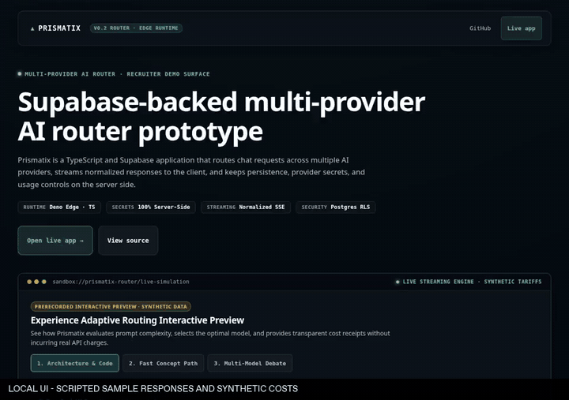
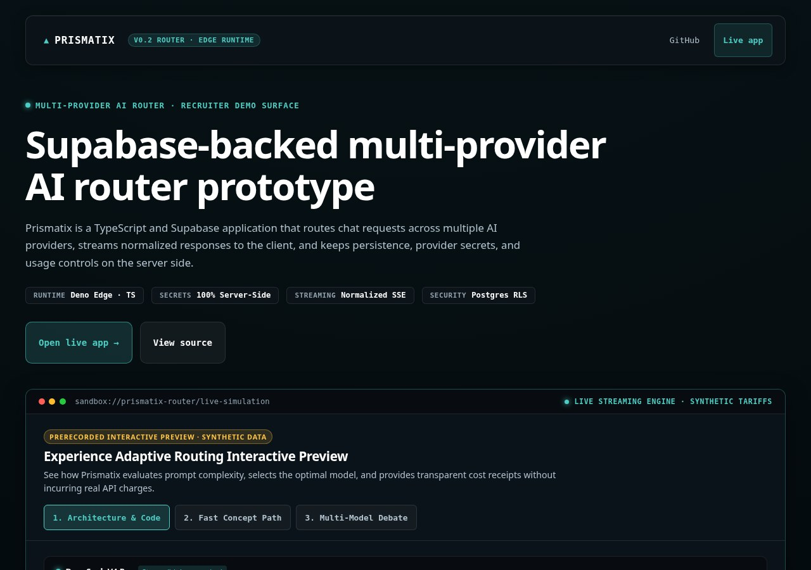
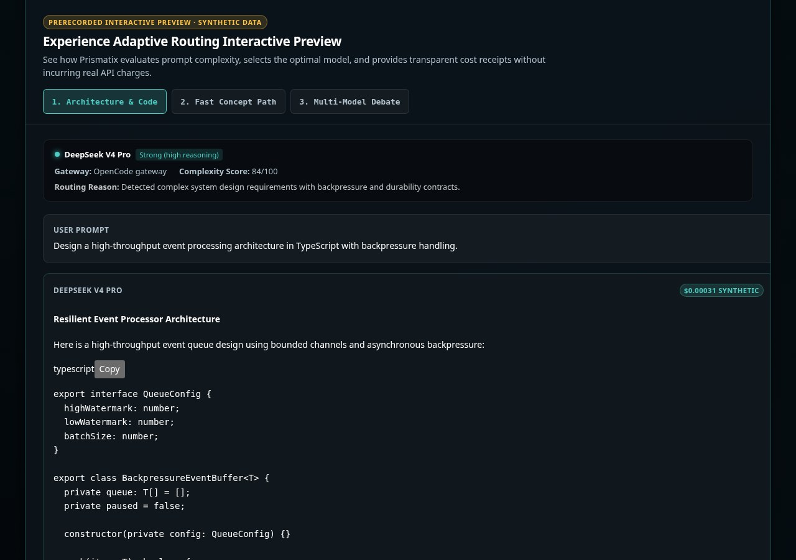
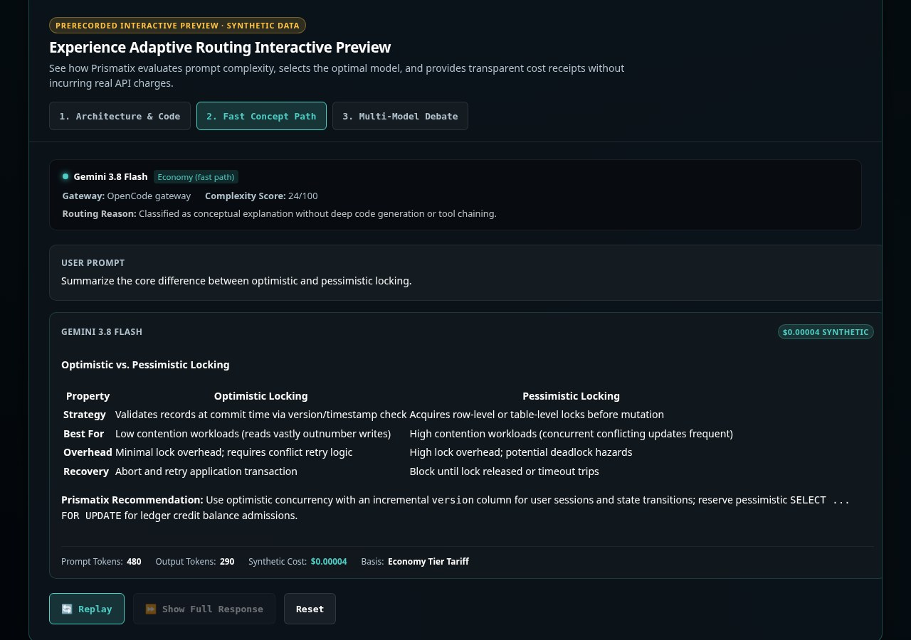
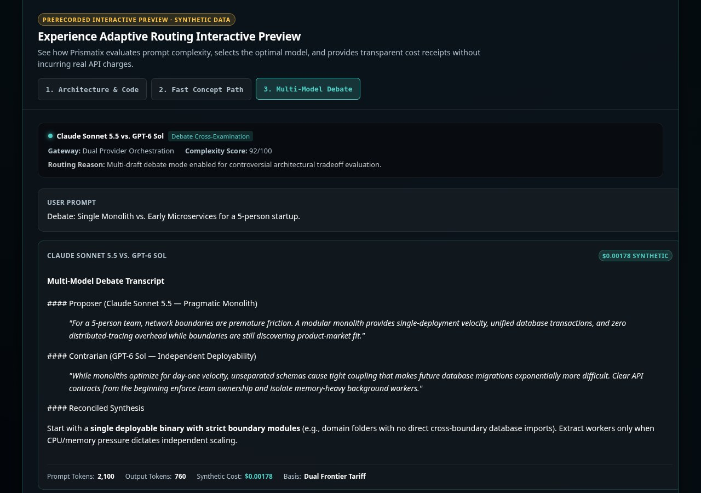

# Prismatix

[](https://github.com/gthgomez/Prismatix/actions/workflows/ci.yml)
[](./LICENSE)
[](https://nodejs.org/)
[](https://www.typescriptlang.org/)

**A personal AI workspace for chatting with multiple models using your own provider keys.**

OpenRouter is the default provider offered during setup. Connect your own key in Provider Settings, then choose a model or let Auto select an eligible priced route. Provider availability depends on the keys you enable, the catalog, and server configuration.

## See it in action

Explore the public sample: replay a scripted response, inspect its route explanation, then switch between concept and debate scenarios.

<a href="docs/showcase/media/workflow.mp4"></a>

[Watch or download the MP4](docs/showcase/media/workflow.mp4) · [Capture notes and reproduction](docs/showcase/README.md)

**What you are seeing:** Real browser capture of the shipped interactive sample. Responses, model names, routing decisions, token counts, and costs in this preview are scripted examples; no provider inference or billing was exercised.

**Demo status:** [Open interactive sample](https://prismatix-app.vercel.app/demo). The public URL returned HTTP 200 on 2026-10-30; authenticated chat and provider availability were not tested.

<table>
<tr>
<td width="50%"><br><strong>1. Public demo</strong><br>Public demo landing page; architecture and public-demo entry point.</td>
<td width="50%"><br><strong>2. Architecture replay</strong><br>Architecture sample replay: scripted stream, route explanation and synthetic cost.</td>
</tr>
<tr>
<td width="50%"><br><strong>3. Fast concept sample</strong><br>Fast concept sample; displayed routing and prices are illustrative.</td>
<td width="50%"><br><strong>4. Debate sample</strong><br>Scripted multi-model debate sample; no model calls were made.</td>
</tr>
</table>

Captured from [`c516e3683d0d`](https://github.com/gthgomez/Prismatix/tree/c516e3683d0dbdc2c0e4aaf46d9556f75a70ae47) on 2026-10-30. The GIF is a compact preview; the MP4 preserves the recorded workflow timing.

---

## What it does

- **Auto routing and cost controls.** The server selects from eligible priced routes based on intent and complexity. The response details show the route, model, and reason when available. The server also applies request, spend, rate, and concurrency limits.
- **Provider connections.** OpenRouter can serve models whose native provider is disabled when the model has an OpenRouter route. The router resolves credentials from the signed-in user's encrypted provider configuration.
- **Multi-provider streaming** — Normalised SSE stream across all gateways and protocols (OpenAI Responses/Chat, Anthropic Messages, Gemini). One client, every model
- **Debate mode (optional)** — Optional multi-model deliberation: parallel challenger models critique the prompt, a synthesis model produces the final answer
- **SMD pipeline** — Structured Multi-Draft: Draft → Skeptic → SynthDecision → Formatter, gated by a fast-path complexity guard (experimental, off by default)
- **Video pipeline (feature-gated)** — Upload, process, and query video assets via Supabase Storage + a background worker edge function
- **Cost tracking** — Pre-flight cost estimates, live token counting during streaming, per-message final cost logged to Supabase `cost_logs`, plus server-side request, daily spend, rate, and concurrent-stream guards. Unknown rates are never shown as $0.00
- **Long-term memory** — Conversation windows are periodically summarised and injected as context on future requests
- **Auth** — Supabase email/password auth with JWT verification on every edge function call

### Auto routing & cost safety — what actually happens

| Situation | Behavior |
|---|---|
| Known price, model discovered | Auto sends; the choice and reason are visible on the message |
| Model price unknown | Request is rejected (`unknown_model_pricing`) — auto *and* manual selection are blocked |
| Model not eligible for auto-routing (e.g. free tier) | Rejected for Auto; explicit manual pick is allowed |
| Discovery unavailable or returns no usable model for the role | Request fails with `auto_route_unavailable` — **no** silent fallback to a costlier legacy model |
| Routed provider not configured | Re-route only to a cheaper priced fallback; otherwise fail closed |
| Curated model unavailable in discovery | Deterministic in-role fallback (primary → fallback list), recorded in the explanation |

Pricing freshness is audited in CI (`npm test`). `supabase/functions/_shared/model_tariff.ts` is the single authoritative source of truth for model pricing across all backend modules and frontend mirrors. `npm run audit:models` enforces committed stale-model budgets.

### Verification scope

The public demo uses scripted responses. CI browser journeys use synthetic users, provider responses, and persistence fixtures. Live provider eligibility and optional workflows depend on the deployed backend and require separate qualification.

---

## Stack

| Layer | Tech |
|---|---|
| Frontend | TypeScript (Vite) — React 18 used only for UI components (~17 `.tsx` files); the bulk of the codebase is plain `.ts` (services, engine, hooks, types) |
| Backend | TypeScript on Deno — edge functions on Supabase |
| AI Providers | OpenRouter and supported direct providers |
| Database | Supabase Postgres (conversations, messages, cost_logs, user_memories, video_assets) |
| Auth | Supabase Auth (JWT, RLS) |
| Deployment | Vercel (frontend) + Supabase (backend) |

---

## Project structure

```
src/
  components/       React components (ChatInterface, Auth, SpendTracker, ...)
  hooks/            Custom hooks (useAuth, useContextManager, useStreamHandler, ...)
  services/         API services (storageService, financeTracker, contextManager)
  styles/           CSS (ChatInterface.css, mobile.css)
  smartFetch.ts     Router API client
  costEngine.ts     Token counting + pricing math
  modelCatalog.ts   UI model registry
  types.ts          Shared TypeScript types

supabase/
  functions/
    router/         Main routing edge function + modules (db_helpers, memory_helpers, video_helpers, ...)
    spend_stats/    Spend statistics aggregation
    video-intake/   Video upload intake
    video-status/   Video processing status
    video-worker/   Background video processing
  migrations/       Postgres schema migrations

docs/               Architecture docs, integration guides, contributing notes
scripts/            Build scripts
```

---

## Environment

Copy `.env.example` to `.env.local` and supply your values:

```env
VITE_SUPABASE_URL=https://YOUR_PROJECT.supabase.co
VITE_SUPABASE_ANON_KEY=your_anon_key
VITE_ROUTER_ENDPOINT=https://YOUR_PROJECT.supabase.co/functions/v1/router
VITE_ENABLE_VIDEO_PIPELINE=false
```

Supabase edge function secrets (set via `supabase secrets set`):

```
OPENROUTER_BASE_URL (optional; defaults to https://openrouter.ai/api/v1)
BYOK_ENCRYPTION_KEY (required for user-connected provider keys; base64, 32 bytes)
ALLOWED_ORIGIN=https://your-frontend.vercel.app
ENABLE_DEBATE_MODE=false
ENABLE_SMD_LIGHT=false
ENABLE_VIDEO_PIPELINE=false
ENABLE_DEEPINFRA=false
ENABLE_OPENROUTER=true
ENABLE_SERVER_SPEND_LIMIT=true
DAILY_SPEND_LIMIT_USD=2
PER_REQUEST_COST_LIMIT_USD=0.5
USER_RATE_LIMIT_WINDOW_MS=60000
USER_RATE_LIMIT_MAX_REQUESTS=20
MAX_ACTIVE_STREAMS_PER_USER=2
```

### Provider plug-ins (BYOK-only)

OpenRouter BYOK is the default. Users connect and enable their own provider keys
in Provider Settings. A model whose native provider is off still becomes
available (and routable) when the user has enabled OpenRouter and the model has
an OpenRouter route. The legacy OpenCode route requires a deployment key and is
disabled in BYOK-only mode. No provider secret configured on the deployment is
used to dispatch user or background work.

- User keys are stored as AES-256-GCM ciphertext (`prismatix_internal.user_provider_keys`)
  and are never returned to the browser; the UI shows only the last 4 characters.
- Set `BYOK_ENCRYPTION_KEY` (base64, 32 bytes) before enabling key entry:
  `openssl rand -base64 32 | supabase secrets set BYOK_ENCRYPTION_KEY --stdin` (or set it directly).
- Provider state is managed by the `provider-settings` edge function
  (`supabase functions deploy provider-settings`).

---

## Development

CI runs the full test suite on Node 24 to match the observed Vercel project runtime. Node 20 and 22 also run clean-install and build checks. The local `.nvmrc` pins Node 22.12.0.

### First-time setup

1. **Install the Supabase CLI** — [docs](https://supabase.com/docs/guides/cli)

2. **Link your project:**
   ```bash
   supabase login
   supabase link --project-ref YOUR_PROJECT_REF
   ```

3. **Run database migrations:**
   ```bash
   supabase db push
   ```

4. **Set edge function secrets** (one-time):
   ```bash
   supabase secrets set ALLOWED_ORIGIN=http://localhost:5173
   supabase secrets set ENABLE_DEBATE_MODE=false
   supabase secrets set ENABLE_SMD_LIGHT=false
   supabase secrets set ENABLE_VIDEO_PIPELINE=false
   supabase secrets set ENABLE_DEEPINFRA=false
   supabase secrets set ENABLE_OPENROUTER=true
   # BYOK: base64 32-byte key for encrypting user-connected provider keys
   supabase secrets set BYOK_ENCRYPTION_KEY="$(openssl rand -base64 32)"
   supabase secrets set ENABLE_SERVER_SPEND_LIMIT=true
   supabase secrets set DAILY_SPEND_LIMIT_USD=2
   supabase secrets set PER_REQUEST_COST_LIMIT_USD=0.5
   supabase secrets set USER_RATE_LIMIT_WINDOW_MS=60000
   supabase secrets set USER_RATE_LIMIT_MAX_REQUESTS=20
   supabase secrets set MAX_ACTIVE_STREAMS_PER_USER=2
   ```

   Do not set deployment provider API keys for user processing. Users save their
   own provider keys in Provider Settings; they are encrypted at rest. Existing
   project/user admission limits remain in force and conservatively count BYOK
   activity until owner-funded and user-funded accounting are separated.

5. **Deploy edge functions:**
   ```bash
   supabase functions deploy router
   supabase functions deploy spend_stats
   supabase functions deploy provider-settings
   ```

6. **Install frontend dependencies and start dev server:**
   ```bash
   npm install
   npm run dev
   ```

### Ongoing development

```bash
npm run dev          # start Vite dev server
npm run type-check   # TypeScript typecheck (no emit)
npm run lint         # ESLint
npm run test         # Vitest unit tests
npm run build        # production build
```

Deploy edge functions after changes:

```bash
supabase functions deploy router
supabase functions deploy spend_stats
supabase functions deploy provider-settings
```

---

## Operational Runbook & Verification

Prismatix provides dedicated operational tooling for verifying production integrity, database ledger health, and routing calibration:

### 1. Verify Deployment Parity
Audit whether production edge functions match the repository commit and check for configuration drift:
```bash
node scripts/check-deployment-parity.mjs
```

### 2. Audit Stale Model Budgets
Enforce the retiring generation coupling ratchet to prevent legacy models from spreading across active code paths:
```bash
node scripts/audit-stale-models.mjs --check
```

### 3. Run Durable Ledger Reconciliation
Process deferred accounting jobs in `prismatix_internal.reconciliation_jobs` (unsettled execution receipts, lease refunds, and terminal job retention):
```bash
# Dry run verification
node scripts/reconcile-jobs.mjs --dry-run

# Live maintenance batch (requires SUPABASE_URL and SUPABASE_SERVICE_ROLE_KEY)
node scripts/reconcile-jobs.mjs --limit 50 --purge-days 30
```

### 4. Synthetic Router Calibration Benchmark
Verify that heuristic routing satisfies quality-to-cost monotonicity and sub-millisecond execution constraints across synthetic prompt categories:
```bash
npx vitest run tests/routing/router_benchmark.test.ts
```

---

## Versioning

Prismatix is a private application, not a published npm package (`"private": true`).
Version history here is release metadata only:

- The `2.0.0` version that appeared in `package.json` for most of this
  repository's life was a historical internal application marker — never
  published to npm and never tagged. See the version-reset migration note in
  [CHANGELOG.md](./CHANGELOG.md).
- The only release tag is the `v0.1.0` prerelease, which is retained unchanged.
- Active development uses the `0.2.0-pre` prerelease line (current:
  `0.2.0-pre.1`). Node/npm floors are declared in `package.json` `engines`
  (`node ^20.19.0 || >=22.12.0`, `npm >=10`) and `.nvmrc` pins Node 22.12.0
  for local development.

## Changelog

See [CHANGELOG.md](./CHANGELOG.md) for release history.

## Contributing

See [CONTRIBUTING.md](./CONTRIBUTING.md) for setup instructions, architecture overview, and PR guidelines.

## License

MIT — [LICENSE](./LICENSE)
