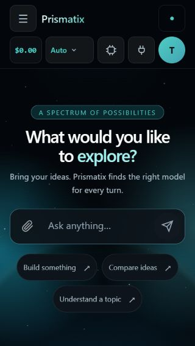
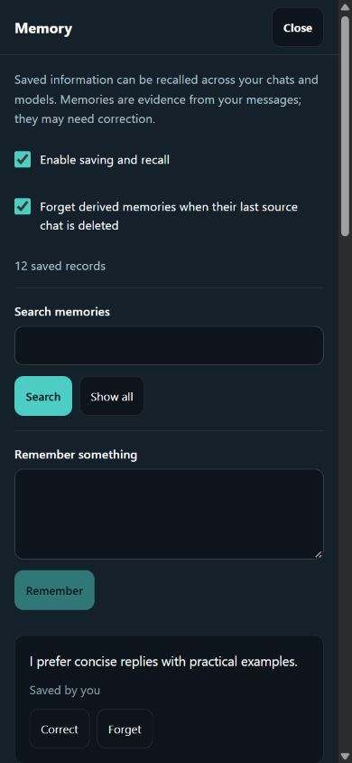
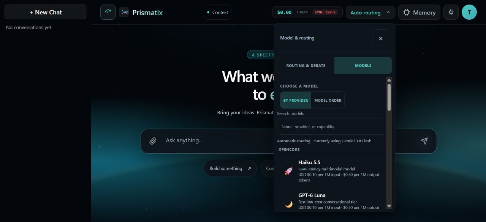
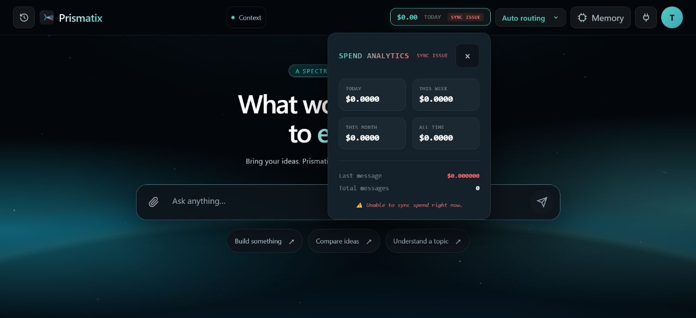
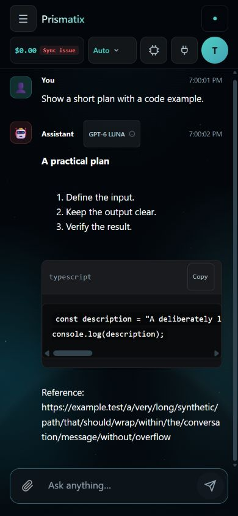

# Prismatix UI/UX audit — 2026-10-11

## Method and scope

OBSERVED: inspected the signed-in production app in Chrome using computer use and screenshots. Covered the empty chat, header, model search/routing controls, memory panel, provider settings, account actions, spending popover and conversation drawer. Checked production at desktop 1279 × 585 and phone 390 × 844; local verification additionally covered 320 × 568.

VERIFIED: rechecked the real frontend components locally with synthetic service fixtures. Exercised long messages/code, starter prompts, keyboard navigation, drawer dismissal, memory search/correction focus, scrolled panel headers and failed spend sync. Fixtures made no provider calls and did not change production memories or provider settings. The temporary fixture harness is excluded from the PR; published screenshots contain synthetic data only.

## Findings and fixes

| Finding | Evidence | Change |
| --- | --- | --- |
| Memory text overflowed its fixed icon button | Production desktop/phone screenshots | Icon plus fitted desktop label; accessible recall count; 44px compact mobile control |
| Long spend status squeezed model selection at 320px | Synthetic error-state screenshot and measured control width | Reserve model control width; omit visual sync badge at the smallest breakpoint while retaining its accessible status |
| Memory panel lost its heading and Close button during scrolling | Production memory screenshot | Reuse sticky settings header and full-height phone layout |
| Memory controls used browser-default gray buttons and cramped spacing | Production memory screenshot | Theme tokens, distinct primary actions, readable cards, larger settings rows and focus styling |
| Primary button hover lost text contrast | Local screenshot during recheck | Keep the primary foreground/background pairing during hover; preserve system colors |
| Correct selected a record without bringing the editor into view | Regression test and local long-list interaction | Focus the correction editor, with scroll padding below the sticky header |
| Refresh showed the full list while retaining a stale search query | Code inspection and regression test | Reset query/search state after refresh; distinguish an empty catalog from empty search results |
| Model menu extended below short desktop viewport and had nested scrolling | Production/local screenshots and DOM measurements | Bound menu height; keep title/tabs fixed with one scrolling content panel |
| Model tabs lacked keyboard arrow navigation and associated panel labels | Regression test and browser key interaction | Roving tab focus; Arrow/Home/End navigation; labelled panel; explicit Close and restored trigger focus |
| Mobile drawer did not dismiss with Escape or move focus inside | Production key interaction and regression test | Focus entry/restoration, Tab wrapping and Escape; hide closed drawer from focus/visibility; preserve rename cancellation |
| Failed spend sync still displayed Connected | Code inspection and reproduced regression test | Truthful sync status, labelled popover, explicit Close/Escape and restored focus |
| Message Copy/model-details controls were too small for touch | Synthetic message screenshot and measured dimensions | Minimum 44px mobile touch targets |

## Checks that passed during the audit

- Provider settings already kept its Close control visible while scrolled; only the shared mobile header gap needed adjustment.
- Historic models remain explicitly collapsed; unmatched model search explains the result.
- Starter prompts fill and focus the composer.
- Long links wrap within messages, and long code scrolls inside the code block without whole-page horizontal overflow.
- The Vercel floating toolbar belongs to the hosting platform, outside the app's controls.

## Screenshot evidence

These are local screenshots of the actual components with synthetic data, not screenshots of a production deployment of this PR.

### Small phone header

### Memory controls

### Bounded desktop model menu

### Truthful spend error

### Message formatting

## Limits

This is a browser UI/UX audit, not a complete accessibility conformance claim. Native screen readers, device keyboards, authentication/account recovery, credential entry, destructive chat deletion, attachment uploads and paid streaming were not exercised in this audit. Production provider credentials and saved personal facts were not modified. Backend routing, billing calculations and database contracts are unchanged.

## Automated verification

VERIFIED: full Vitest suite, 610 tests across 63 files, with one worker. Typecheck and production build passed. Lint passed with zero errors and 48 existing warnings. The enforced stale-model coupling check passed with its budget unchanged. Six new interaction regressions were first observed failing, then passing after their fixes. Final diff inspected; temporary fixtures and production screenshots excluded from publication.
